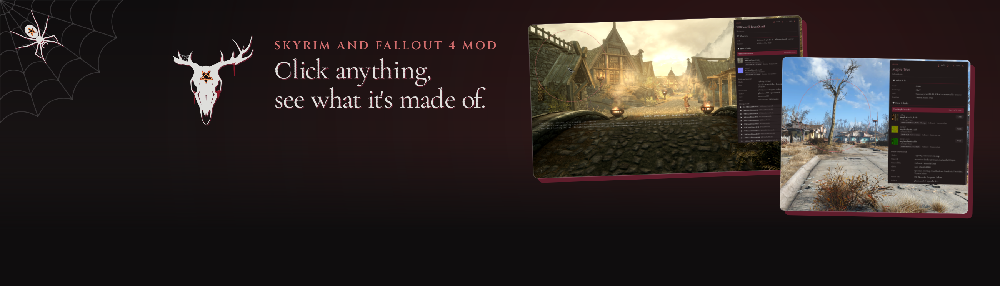
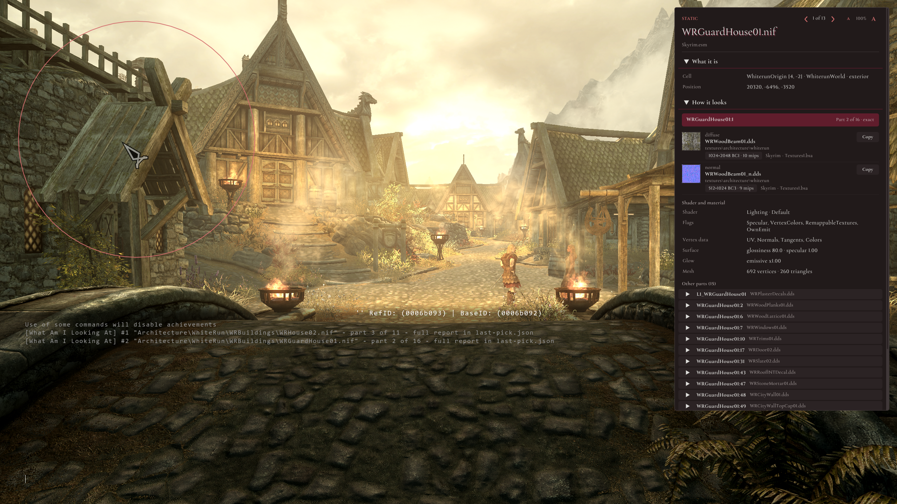
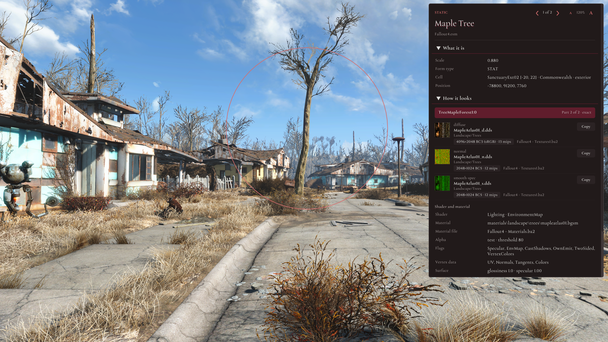
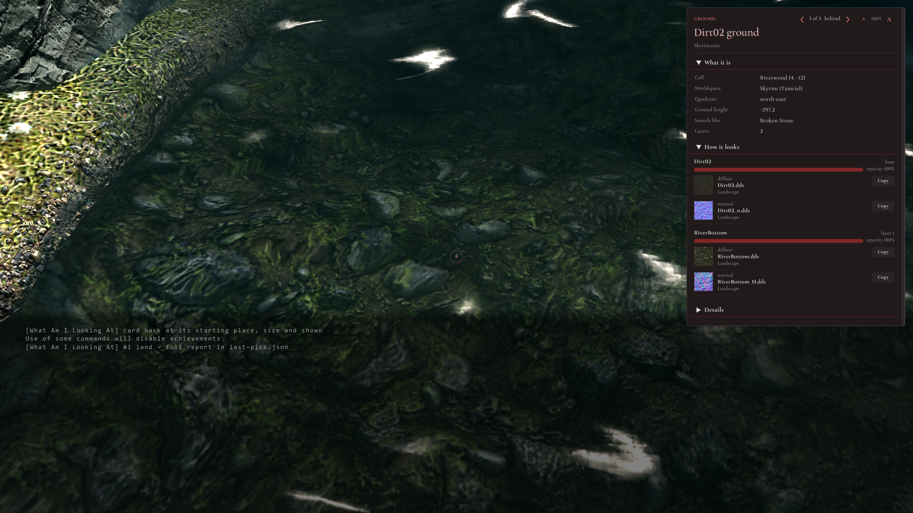
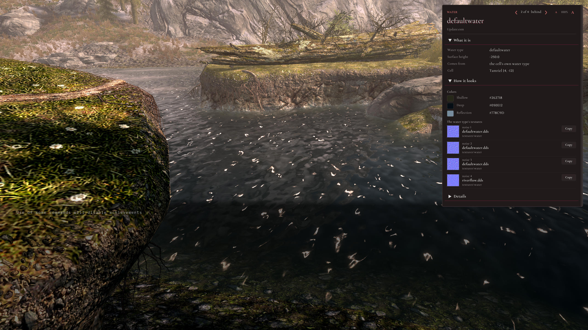

<p align="center">

</p>

Open the console and click anything in Skyrim or Fallout 4 to see exactly which part you hit: its textures, shader and flags, on a card you can move and resize.

<p align="center"><picture>
  <source media="(prefers-color-scheme: dark)" srcset="docs/divider.png">
  
</picture></p>

## How it works

- **Click to look.** With the console open (the `~` key), left-click an object, bare ground, water or the sky. The card appears and names what you picked.
- **The exact part, not just the model.** A building is dozens of parts. The card marks the one you clicked and shows its textures as thumbnails, with each file's name, size, mip count and the archive it came from.
- **Shader and material.** The shader, flags, glossiness, vertex data and mesh size (and on Fallout 4 the material file).
- **Where it comes from (Fallout 4).** Each part shows its mesh file, where that file lives (an archive or a mod folder) and which mod adds it. Weapon mods show the plugin that adds them, and any plugin that changes them.
- **Step through what is there.** The arrows in the card's header move to the next thing along the same line of sight: the parts behind, then the ground under it. Typing `lookingat next` does the same.
- **Characters too.** Click a person or creature to see its skin and armor parts the same way.

<p align="center"></p>

<p align="center"></p>

- **Bare ground.** Its texture layers and how much of each shows, plus the cell, the ground height and what the ground sounds like.
- **Water.** The water type, its shallow, deep and reflection colors, and the wave textures it uses.
- **Warnings.** When a part has a problem the card can spot, like a missing texture, a normal map with no mip levels or an uncompressed normal map, a red line says what and why.
- **The full report.** Every pick is also saved to `last-pick.json`, with everything on the card and more.

<p align="center"></p>

<p align="center"></p>

## Install

Download the file for your game from Nexus Mods, install it with your mod manager or copy its `SKSE` or `F4SE` folder into the game's Data folder, and start the game through the script extender as usual. Open the console, then left-click something.

Requires the Skyrim Script Extender (SKSE64) and Address Library for SKSE Plugins, or the Fallout 4 Script Extender (F4SE) and Address Library for F4SE Plugins, plus the Microsoft Visual C++ 2015-2022 Redistributable (x64).

Tested on Skyrim SE 1.5.97 and AE 1.6.1170 and 1.7.104, and Fallout 4 OG 1.10.163, NG 1.10.984 and AE 1.11.240. The Fallout 4 build is one DLL for all three.

## Choose what it does

Settings are in `Data\SKSE\Plugins\WhatAmILookingAt.ini` (Skyrim) or `Data\F4SE\Plugins\WhatAmILookingAt.ini` (Fallout 4), and every key is optional:

```ini
[General]
Enabled=1
ConsoleClick=1
PrintToConsole=1
WriteJson=1
ShowCard=1
CardScale=1.0
CardCorner=top-right
```

`ConsoleClick=0` turns off click picking (the `lookingat` command still works), `ShowCard=0` keeps only the console lines and the file, `CardScale` sets the card's size and `CardCorner` where it starts.

With the console open you can also drag the card by its header, drag its edges to resize it, or use the A buttons in its header or Ctrl and the mouse wheel to change its size. It remembers where you left it, and `lookingat card_reset` puts it back.

## Good to know

- **Console only.** The card shows only while the console is open, and there are no hotkeys.
- **The `lookingat` command.** `lookingat` shows what the crosshair points at (or the reference you selected in the console), `lookingat <ref id>` a specific reference, and `lookingat ground`, `water` or `sky` ask for that kind. It takes over one console command that does nothing in the retail game.
- **It works with More Informative Console** on Skyrim (tested together on SE 1.6.1170). A tall card can cover its lines on the right, so drag the card aside.
- **Skinned meshes.** Characters and some trees are skinned, so the line of sight can only tell you which part's bounds you pointed at, not the exact spot.
- **It reads, it doesn't change.** Nothing in your game is edited.

<details><summary>Build it yourself</summary>

You need Visual Studio 2022's C++ build tools, CMake, Ninja and vcpkg, and the submodules:

```
git submodule update --init --recursive
set TI_CACHE=<a folder for build trees and caches>
build.bat tests
build.bat skyrim
build.bat fo4
```

`tests` builds and runs the offline checks, and the plugin builds write the mod folders to `dist`. `build.local.bat` (git-ignored) can hold `TI_CACHE` and the other settings listed at the top of `build.bat`.

</details>

## Report a problem

**Found a bug?** Post on the Nexus page's Bugs tab with your game version, what you saw, and this mod's log. I need it for every report, because it shows what the mod actually did:

```
Documents\My Games\Skyrim Special Edition\SKSE\WhatAmILookingAt.log
Documents\My Games\Fallout4\F4SE\WhatAmILookingAt.log
```

Send it before you start the game again, because each launch replaces it.

**If the game crashed,** I need two logs: this mod's log, plus the crash log from a crash logger (Crash Logger or Trainwreck on Skyrim, Buffout 4 NG or Addictol on Fallout 4). Without both, I can't tell what crashed or why.

Reports without the logs are closed after 14 days. Post them later and I'll reopen the report.

Logs are long, so link a paste site or bring them to [Discord](https://discord.com/invite/sayngwyn). They can show your Windows username, so use a private report on Nexus if you'd rather.

## More by sayngwyn

[](https://www.nexusmods.com/profile/sayngwyn/mods)

Also on [my website](https://sayngwyn.com/projects).

## Credits

- **The SKSE and F4SE teams** for the script extenders it loads through.
- **Address Library for SKSE Plugins and for F4SE Plugins** for finding the game's functions across versions.
- **CommonLibSSE-NG** and **commonlibf4** (the Dear-Modding-FO4 fork) for reading each game's data.
- **Dear ImGui** for drawing the card.
- **DirectXTK, DirectXMath, fmt, spdlog, SimpleIni, robin-hood-hashing, rapidcsv and xbyak** for the plumbing underneath.
- **Cinzel and Cormorant Garamond** for the letters the card's font is built from.

---

Made with AI. Claude contributed heavily under my direction: I decided what it does and checked it, and the AI wrote most of the code, its tests and these docs.

## License

GPL-3.0-or-later. See [LICENSE](LICENSE). The card's fonts are under the SIL Open Font License (`dist-src/fonts/OFL.txt`). The sayngwyn skull mark and page art aren't covered by the code's license.
